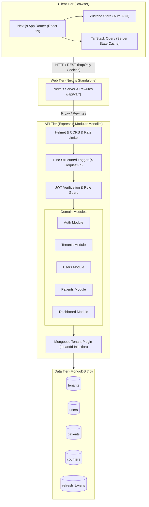

# Laboratory Management System (LMS)

A production-grade, multi-tenant web Laboratory Management System (LMS) built as a high-performance modular monolith. Multiple diagnostic laboratories (tenants) securely share a single MongoDB database with strict data isolation enforced at the schema and query layers, granular Role-Based Access Control (RBAC), and high-performance server-side data workflows.

---

## Table of Contents
- [Overview](#overview)
- [Screenshots](#screenshots)
- [Architecture Diagram](#architecture-diagram)
- [How to Run](#how-to-run)
  - [With Docker (Recommended)](#with-docker-recommended)
  - [Without Docker (Local Development)](#without-docker-local-development)
- [Environment Variables](#environment-variables)
- [Seed Users & Credentials](#seed-users--credentials)
- [Test & Verification Commands](#test--verification-commands)
- [Folder Structure](#folder-structure)
- [Design Decisions](#design-decisions)

---

## Overview

- **Multi-Tenant Data Isolation**: Centralized Mongoose plugin (`tenantPlugin`) automatically injects `tenantId` into queries, mutations, and aggregation pipelines, backed by compound database indexes for sub-65ms queries on 100,000+ records.
- **Granular RBAC**: 4 distinct roles (`SUPER_ADMIN`, `LAB_ADMIN`, `DOCTOR`, `RECEPTIONIST`) with strictly enforced route guards, API permissions, and role-tailored dashboard navigation.
- **Stateless Authentication**: Dual-token JWT architecture (short-lived access token, long-lived refresh token in `httpOnly` secure cookies) with automatic silent refresh and token revocation on logout.
- **Next.js App Router Frontend**: React 19, Tailwind CSS v4, shadcn/ui components, dual color palettes (`navy` & `cream`), dark/light theme switching, and collapsible sidebar.
- **State Management**: Zustand with narrow selectors for client state and TanStack Query for server state caching, pagination smoothing, and targeted invalidations.
- **Observability & Security**: Structured JSON logging with Pino (`X-Request-Id` tracing), Helmet security headers, CORS origin protection, per-IP rate limiting, and Sentry error tracking.

---

## Screenshots

> *Placeholder previews for core dashboard views.*

### 1. Dashboard Overview

*Role-aware metrics, operational KPIs, active labs/users stats, and patient registration trends.*

### 2. Laboratory Management (Super Admin)

*Multi-tenant laboratory facility directory with status toggles, user distribution counts, and tenant creation modals.*

### 3. Patient Directory & Search

*Paginated patient directory with instant debounced prefix search, status filters, and tabular formatting.*

### 4. Patient Details & Medical Records

*Two-column clinical layout with demographic records, mono-font patient codes, status tags, and role-guarded action dialogs.*

### 5. User & Staff Management

*Tenant staff administration, role assignment, and account activation controls.*

---

## Architecture Diagram



---

## How to Run

### With Docker (Recommended)

One command starts MongoDB, the Express API, and the Next.js web application:

```bash
docker compose up --build
```

- **Frontend (Web)**: [http://localhost:3000](http://localhost:3000)
- **Backend API**: [http://localhost:5000](http://localhost:5000)
- **API Health Check**: [http://localhost:5000/api/v1/health](http://localhost:5000/api/v1/health)

To stop the containers:
```bash
docker compose down
```

---

### Without Docker (Local Development)

#### Prerequisites
- Node.js (v20+ or v22+ recommended)
- MongoDB instance running locally on `mongodb://localhost:27017` or a MongoDB Atlas connection string
- npm (v10+)

#### 1. Backend Setup

```bash
cd backend

# Install dependencies
npm install

# Configure environment variables
cp .env.example .env

# Seed initial superadmin and demo laboratory data
npm run seed

# Start development server with live reload
npm run dev
```
The API starts at [http://localhost:5000](http://localhost:5000).

#### 2. Frontend Setup

```bash
cd frontend

# Install dependencies
npm install

# Configure environment variables
# BACKEND_URL=http://localhost:5000
# NEXT_PUBLIC_API_BASE=/api/v1
cp .env.example .env.local

# Start development server
npm run dev
```
The frontend starts at [http://localhost:3000](http://localhost:3000).

---

## Environment Variables

### Backend (`backend/.env`)

| Variable | Description | Default |
|---|---|---|
| `NODE_ENV` | Application environment (`development`, `production`, `test`) | `development` |
| `PORT` | HTTP server port | `5000` |
| `MONGODB_URI` | MongoDB connection string | `mongodb://localhost:27017/lms` |
| `JWT_ACCESS_SECRET` | Secret key for signing short-lived access tokens (min 32 chars) | — |
| `JWT_REFRESH_SECRET` | Secret key for signing refresh tokens (min 32 chars) | — |
| `ACCESS_TOKEN_TTL` | Access token lifespan | `15m` |
| `REFRESH_TOKEN_TTL` | Refresh token lifespan | `7d` |
| `BCRYPT_ROUNDS` | Salt rounds for hashing passwords | `12` |
| `CLIENT_ORIGIN` | Allowed CORS origin URL | `http://localhost:3000` |
| `COOKIE_DOMAIN` | Domain for authentication cookies (optional) | `""` |
| `LOG_LEVEL` | Logging level (`fatal`, `error`, `warn`, `info`, `debug`) | `info` |
| `SENTRY_DSN` | Sentry DSN for error telemetry (optional) | `""` |
| `SEED_SUPER_ADMIN_EMAIL` | Default Super Admin account email | `superadmin@lms.local` |
| `SEED_SUPER_ADMIN_PASSWORD` | Default Super Admin account password | `SuperAdminPassword123!` |

### Frontend (`frontend/.env.local`)

| Variable | Description | Default |
|---|---|---|
| `BACKEND_URL` | Backend API URL used by Next.js server rewrites | `http://localhost:5000` |
| `NEXT_PUBLIC_API_BASE` | Public API base path | `/api/v1` |

---

## Seed Users & Credentials

Running `npm run seed` in `backend/` creates idempotent platform accounts:

| Role | Name | Email | Password | Scope / Tenant |
|---|---|---|---|---|
| **Super Admin** | Super Admin | `superadmin@lms.local` | `SuperAdminPassword123!` | System-wide (all tenants) |
| **Lab Admin** | Demo Lab Admin | `admin@demodiagnostics.local` | `DemoStaffPassword123!` | Demo Diagnostics |
| **Doctor** | Dr. Sarah Smith | `doctor@demodiagnostics.local` | `DemoStaffPassword123!` | Demo Diagnostics |
| **Receptionist** | John Receptionist | `receptionist@demodiagnostics.local` | `DemoStaffPassword123!` | Demo Diagnostics |

---

## Test & Verification Commands

### Backend Verification

```bash
cd backend

# Run ESLint validation
npm run lint

# Compile TypeScript
npm run build

# Run unit and integration test suite (Vitest)
npm test

# Seed standard demo data (50 patients)
npm run seed

# Seed high-volume performance dataset (e.g. 100,000 patients)
npm run seed -- --patients=100000
```

### Frontend Verification

```bash
cd frontend

# Run ESLint validation
npm run lint

# Run TypeScript type check
npx tsc --noEmit

# Run production standalone build
npm run build
```

---

## Folder Structure

```text
llms-management-system/
├── backend/
│   ├── src/
│   │   ├── config/          # Environment validation, database, logger, Sentry
│   │   ├── constants/       # User roles, permissions, error codes
│   │   ├── middlewares/     # Auth, RBAC, error handler, rate limiter, request ID
│   │   ├── modules/
│   │   │   ├── auth/        # Login, refresh, logout, token service
│   │   │   ├── dashboard/   # Metrics and analytics endpoints
│   │   │   ├── patients/    # Patient schema, service, controller, counter
│   │   │   ├── tenants/     # Tenant management schema, service, controller
│   │   │   └── users/       # User accounts schema, service, controller
│   │   ├── plugins/         # Mongoose multi-tenant isolation plugin
│   │   ├── scripts/         # Idempotent database seeder
│   │   ├── types/           # Express request extensions, shared interfaces
│   │   ├── app.ts           # Express app setup and middleware pipeline
│   │   └── server.ts        # Server entry point
│   ├── tests/               # Vitest unit, isolation, and security test suites
│   ├── Dockerfile           # Multi-stage production container
│   └── package.json
│
├── frontend/
│   ├── src/
│   │   ├── app/             # Next.js App Router pages and layouts
│   │   │   ├── (auth)/      # Public login route
│   │   │   └── (dashboard)/ # Protected dashboard, labs, users, patients routes
│   │   ├── components/
│   │   │   ├── layout/      # AppHeader, AppSidebar, NavUser, Breadcrumbs, ThemeToggle
│   │   │   ├── shared/      # DataTable, Pagination, Avatar, Badges, Skeletons
│   │   │   └── ui/          # shadcn/ui primitive components
│   │   ├── constants/       # Navigation items, roles, permissions
│   │   ├── features/        # Feature modules (auth, dashboard, labs, patients, users)
│   │   ├── hooks/           # Shared React hooks (mobile, debounce)
│   │   ├── lib/             # API client, query keys, palette utilities
│   │   └── stores/          # Zustand auth slice with narrow selectors
│   ├── public/              # Static assets and icons
│   ├── Dockerfile           # Multi-stage Next.js standalone container
│   ├── next.config.ts       # Standalone output configuration & API rewrites
│   └── package.json
│
├── docs/                    # Architecture, design, API contracts, and security rules
├── docker-compose.yml       # Production orchestration (MongoDB, API, Web)
└── README.md
```

---

## Design Decisions

### 1. Why Zustand?
- **Narrow Subscriptions**: Zustand stores allow components to subscribe strictly to the exact slices of state they need (e.g., `useAuthStore((s) => s.user?.role)`).
- **Zero Overhead**: Unlike React Context, updating an authentication state or theme does not cause re-render cascading down the component tree.
- **Client-Only Boundary**: Kept minimal for client-only state (authenticated user metadata and session hints), keeping the bulk of state management decoupled from UI rendering.

### 2. Why TanStack Query?
- **Server State Decoupling**: Components do not hold server data in `useState`. TanStack Query manages asynchronous fetching, caching, deduplication, and stale data revalidation.
- **Smooth Pagination**: Configured with `placeholderData: keepPreviousData`, allowing page navigation and search typing without UI flashes or layout shift.
- **Granular Cache Invalidation**: Mutations only invalidate targeted query keys (e.g., `queryKeys.patients.all`), preserving unaffected cached views.

### 3. Why Tenant Plugin at the Schema Layer?
- **Fail-Safe Isolation**: Enforcing multi-tenant isolation at the database layer through a Mongoose plugin (`tenantPlugin`) guarantees that every query, update, and deletion automatically incorporates `tenantId`.
- **Developer Safety**: Eliminates the risk of developers writing queries that accidentally omit tenant filters.
- **Compound Index Alignment**: Guarantees that query patterns match database compound indexes (`{ tenantId: 1, name: 1 }`, `{ tenantId: 1, createdAt: -1 }`), maintaining sub-65ms latency at scale.

### 4. Why are Redis, Microservices, and ABAC Deferred?
Adding infrastructure components before measuring actual bottlenecks introduces unnecessary operational overhead:

| Technology | Why Deferred Now | Trigger to Adopt |
|---|---|---|
| **Redis** | Data fits in memory with MongoDB compound indexes and client-side staleTime caching. Stateless JWTs avoid session lookups. p95 query latency is under 65ms on 100,000 records. | Distributed rate limits across multiple container instances, BullMQ background jobs, or repeated expensive aggregation queries. |
| **Microservices** | Monolithic modularity provides clear module boundaries without distributed network latency, split-brain transactions, or orchestration overhead for current workloads. | When a specific module (e.g. automated test instruments or report PDF generation) requires distinct scaling or separate team ownership. |
| **ABAC** | Granular 4-tier RBAC (`SUPER_ADMIN`, `LAB_ADMIN`, `DOCTOR`, `RECEPTIONIST`) fully satisfies all clinical workflows and compliance boundaries. | When complex contextual policies (e.g. "doctor can only view patients with active consultations during current shift") are needed. |
